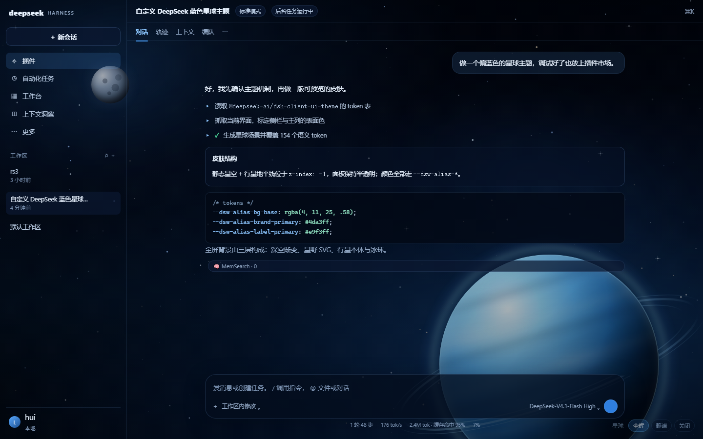

# 蔚蓝星球 · Azure Planet

深空星野 + 蓝色星球地平线的 **DeepSeek Harness** 主题。整套 `--dsw-alias-*` 语义色被重新调成深海蓝，主界面面板保持半透明，让行星的弧线、星环和大气辉光从界面后面透出来。



## 特点

- **完整 token 覆盖**：154 个 `--dsw-alias-*` 与常用 `--dsw-specific-*` 变量，浅色 / 深色两套都强制为深蓝，切换系统主题不会闪回白色。
- **会动的星球场景**：深空渐变、星野 SVG、星云、月亮、带大气层 / 星环 / 云带 / 明暗终止线的冰蓝行星，全部由 CSS + SVG 绘制，无外部图片依赖。星野缓缓漂移、星云明灭、行星悬浮呼吸、云带缓慢翻涌、月亮轻晃，偶有彗星划过——所有动画只用 transform / opacity，页面隐藏时全部暂停。
- **面板真正透明**：覆盖 `sidebarCol`、`centerCol` 和聊天根容器 `*_root` 的背景，行星不会被不透明底盖住。
- **右下角 HUD**：`星球` 标签 + `全辉 / 静谧 / 关闭` 三种动效模式。全辉=完整动效，静谧=画面变暗且完全静止（适合专注阅读），关闭=隐藏场景。选择记在 `localStorage`（键 `dsh-theme-blue-planet/mode`），刷新后保留。
- **礼貌的动效**：页面隐藏时暂停；`prefers-reduced-motion: reduce` 下自动降级为静态场景。

## 安装

从 GitHub 安装（市场条目同步中）：

```bash
dsh plugin --profile desktop add github:lianghui32/dsh-theme-blue-planet
```

也可以下载 [最新 release](https://github.com/lianghui32/dsh-theme-blue-planet/releases) 里的 `.tgz`，拖进市场安装。安装后主题立即生效（Host 热挂载）。

## 说明

- 这是一个 **skin**：它强制深蓝配色，不注册 `ThemeService`，所以不会出现在“浅色 / 深色 / 跟随系统”的主题选择器里。想恢复原样，禁用或卸载本插件即可。
- 星环、云带在真实界面里是“透过半透明面板看到的背景层”，会比预览图更淡；这是为了让正文保持可读。
- 动画全部是缓慢的（几十秒到几分钟一个周期），盯着看几秒才能察觉位移；这不是 bug，是设计。
- 推荐在 1280×800 以上窗口使用；更小的窗口会隐藏 HUD 标签，只保留按钮。

## 兼容性

- DSH `>= 0.1.7`
- Web 客户端（桌面端内置浏览器 / Chrome / Edge）

## License

MIT © lianghui
